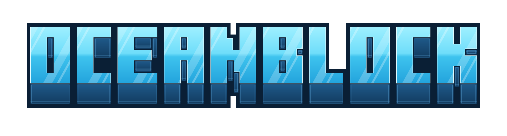

<p align="center">
  
</p>

<p align="center">
  Servidor de sobrevivência em ilhas no meio do oceano, para Paper 26.3, escrito em Kotlin.
</p>

---

Cada jogador começa numa ilha pequena no mar aberto. Ele puxa detritos que passam boiando, gera minério com lava e água, monta máquinas movidas a energia, sobe de nível, cumpre missões e defende a ilha de piratas. O servidor entrega um resource pack próprio, gerado pelo plugin **Textura**, com telas, HUD, notificações, blocos e itens personalizados.

## Sumário

- [Funcionalidades](#funcionalidades)
  - [Escolha da ilha](#escolha-da-ilha)
  - [A ilha](#a-ilha)
  - [Deriva, Gancho e Rede de Detritos](#deriva-gancho-e-rede-de-detritos)
  - [Recursos do mar](#recursos-do-mar)
  - [Receitas](#receitas)
  - [Máquinas e energia](#máquinas-e-energia)
  - [Nível](#nível)
  - [Missões](#missões)
  - [Recompensas por tempo online](#recompensas-por-tempo-online)
  - [Raid de piratas](#raid-de-piratas)
  - [Venda](#venda)
  - [Notificações e HUD](#notificações-e-hud)
  - [Pequenas comodidades](#pequenas-comodidades)
  - [Sistemas herdados do one-block](#sistemas-herdados-do-one-block)
- [Comandos](#comandos)
- [Textura e Textura Studio](#textura-e-textura-studio)
- [Rodando o projeto](#rodando-o-projeto)
- [Estrutura do repositório](#estrutura-do-repositório)

## Funcionalidades

### Escolha da ilha

No primeiro login o jogador fica como espectador sobre o mar e escolhe o tipo da ilha numa tela própria, no estilo dos seletores de modo de jogo. A escolha é permanente: só um admin troca, com `/ilha resetplayer`.

| Tipo | Como é |
|---|---|
| **Padrão** | A ilha de grama original, com árvore, lago e gerador de pedra. |
| **Deserto** | Areia, arenito, árvore seca e arbustos mortos, num bioma de deserto. |
| **Gelo** | Neve, abeto e camadas de neve, num bioma nevado; a água da ilha não congela. |
| **Jangada** | Só uma jangada 3×3 de madeira no meio do mar. Modo difícil. |

Os tipos mudam só a aparência. Detritos, gerador, XP e missões são iguais em todos.


### A ilha

- **`/ilha`** abre o painel da ilha: o seu personagem, os membros, o status e os atalhos para membros, melhorias, configurações, visitas, nível, missões e receitas. `/ilha menu` abre a mesma coisa em baú simples.
- **Membros:** o dono convida (`/ilha convidar <jogador>`). O convite vale 60 s e é aceito com um clique. Cabem `(nível de Membros + 1) × 3` jogadores.
- **Visitas:** a ilha pode ser pública ou privada, e o dono bloqueia quem quiser.
- **Configurações:** chaves por ilha, como spawn natural de mobs.
- **Melhorias:** compradas com Coins. A principal é o **Gerador**.
- **Gerador de pedra:** lava + água viram um sorteio de blocos. No nível 0 saem pedregulho, pedra, carvão, cobre e ferro; os níveis 1 a 4 (25k, 100k, 400k e 1,5M de Coins) liberam lápis, redstone, ouro, esmeralda e diamante. A tabela fica em `gerador.yml`.


### Deriva, Gancho e Rede de Detritos

Uma correnteza passa ao lado de cada ilha trazendo detritos que boiam, balançam, mergulham por baixo de obstáculos, encalham e somem depois de um tempo.

- **Gancho:** vara de pesca que puxa o detrito mais próximo do anzol. Todo jogador novo ganha um.
- **Toque:** encostar num detrito também coleta.
- **Rede de Detritos:** bloco com 27 espaços que pega sozinho os detritos que passam perto. Até 4 por ilha. Os itens guardados aparecem deitados no chão da rede.
- Cada detrito sorteia o que vai dar quando nasce, e a sucata já boia com a cara do item que vai entregar.

| Detrito | Peso | O que dá |
|---|---|---|
| Sucata | 80 | gravetos, tábuas, pepitas de ferro, folhas, terra, sílex, mudas, um pouco de linha |
| Barril | 8 | pão, linha, alga, bacalhau, às vezes ferro e concha de náutilo |
| Rede rasgada | 6 | 2 a 4 linhas |
| Recife | 3 | fragmentos e cristais de prismarinho |
| Barril de ferro | 1 | lingotes, redstone, esmeralda e 8% de chance de diamante |


### Recursos do mar

Alguns recursos só existem no mar. A **linha** não cai de aranha, teia, baú de estrutura nem presente de gato: vem só de detritos, da rede, do Gancho e da pesca. O **prismarinho** vem do recife e é o que move o Gerador e o Painel solar.

### Receitas

Os itens do OceanBlock são feitos no **`/receitas`**, e não na bancada. O menu separa as receitas por categoria (Ferramentas, Coleta, Estações, Máquinas), mostra quantos itens você tem de cada ingrediente e libera cada receita num nível do jogador. As únicas receitas de bancada são os **paxels** (machado, picareta e pá do mesmo material em cima, dois gravetos no meio), de ferro, diamante e netherite.


### Máquinas e energia

As máquinas trocam energia pelo ar: um consumidor puxa de qualquer fonte da mesma ilha num raio de 8 blocos, e um feixe de luz amarela mostra de onde veio.

| Máquina | Nível | O que faz |
|---|---|---|
| **Gerador de energia** | 18 | Queima recursos do mar: alga seca (800 E), bloco de alga seca (8.000 E) e fragmento de prismarinho (3.200 E). Bateria de 10.000 E e 14 vagas de combustível. |
| **Painel solar** | 20 | Gera energia de dia, com céu aberto. |
| **Fornalha elétrica** | 22 | 4 filas independentes que derretem qualquer receita de fornalha, com tela ao vivo. |
| **Minerador** | 25 | Quebra o bloco de baixo, que o gerador de pedra repõe, e guarda os drops ou manda para um baú ao lado. |
| **Brocas** | 28 a 40 | Ouro, diamante, obsidiana e netherite deixam o Minerador mais rápido. |
| **Picareta fundidora** | 12 | Já entrega os minérios derretidos e funciona com Fortuna. |


### Nível

O jogador vai do nível 1 ao 50. O XP vem de:
- detritos coletados (sucata 4, barril 10, barril de ferro 25…);
- blocos do gerador de pedra;
- receitas feitas no `/receitas`;
- mobs mortos (passivos 1, zumbi 3, creeper 5, enderman 8…).

Cada subida dá 100 Coins por nível e libera receitas. **`/nivel`** mostra o caminho dos 50 níveis com o que cada um libera.


### Missões

- **Trilha:** 15 missões em sequência, da "Primeira pescaria" ao "Capitão da ilha", que ensinam o jogo na primeira hora. O `/missoes` mostra o caminho em zigue-zague.
- **Diárias:** 3 por dia, renovadas à meia-noite (horário de Brasília) e liberadas desde o início, junto com a trilha. O jogador escolhe qual vale agora, e só essa conta. Trocar de diária guarda o progresso da anterior.
- A missão ativa aparece num cartão no topo da tela, com barra de progresso. Ele some quando não há diária escolhida.


### Recompensas por tempo online

Marcos de tempo jogado, de 30 minutos a 100 horas, dão Coins, Pérolas, XP e itens. Ao atingir um marco aparece um aviso, e o resgate é feito no **`/recompensas`**.


### Raid de piratas

A partir do nível 10, a cada 10 minutos uma ilha com jogador presente tem 3% de chance de ser invadida, no máximo uma vez por dia.

- Os piratas chegam de barco, em 3 ondas, e a raid dura 5 minutos. A última onda traz o **Super Pirata**.
- Piratas derrubam moedas e pérolas que viram Coins e Pérolas ao serem pegas.
- Vencer dá Coins e XP a todos os membros na ilha. Se o tempo acaba, os piratas fogem.
- Durante a raid, um HUD próprio no topo mostra as ondas, os piratas vivos e o tempo.


### Venda

**`/sell`** abre um baú: o que tiver preço é vendido por Coins, e o resto volta para o inventário. `/sell inventario` vende tudo o que você carrega, e `/valores` mostra a tabela de preços.


### Notificações e HUD

Tudo usa o mesmo padrão visual: um selo colorido com ícone e um corpo escuro translúcido.

- **Avisos (toasts):** subida de nível, marco de tempo e invasão no canto superior direito; vendas no canto superior esquerdo. Eles entram deslizando, empilham e somem sozinhos.
- **Coleta e XP:** `+N item` ao coletar e `+N XP` ao lado da mira.
- **HUD fixo:** o cartão de missão e o HUD da raid no topo da tela.


### Pequenas comodidades

- **F no baú:** com um baú, barril ou shulker aberto, apertar F sobre um slot junta os itens iguais e ordena do mais numeroso para o menos.
- **`/pref`:** preferências do jogador, como mostrar ou esconder o rastro de energia.
- **Ganhos no scoreboard:** nível, Coins, Pérolas e tempo jogado no placar lateral.

### Sistemas herdados do one-block

O OceanBlock é um fork do one-block e mantém alguns sistemas dele: mercado entre jogadores (`/mercado`), coinflip (`/coinflip`), coleções (`/colecoes`), encantamentos personalizados (`/encantamentos`), passe de batalha (`/passe`, `/desafios`), loja (`/shop`), rankings (`/tops`), mercador (`/trader`) e kit inicial.

## Comandos

| Comando | O que faz |
|---|---|
| `/ilha` | Painel da ilha; sem ilha, abre a escolha do tipo |
| `/ilha ir` | Vai para a sua ilha |
| `/ilha convidar <jogador>` / `/ilha aceitar` | Convida e aceita membros |
| `/receitas` | Menu de receitas |
| `/nivel` | Caminho dos níveis |
| `/missoes` | Trilha e diárias |
| `/recompensas` | Recompensas por tempo online |
| `/sell`, `/sell inventario`, `/valores` | Venda |
| `/pref` | Preferências |
| `/coins`, `/perolas` | Saldo |

Comandos de admin:

| Comando | O que faz |
|---|---|
| `/ilha resetplayer <nick>` | Apaga a ilha e manda o jogador escolher de novo |
| `/nivel dar <jogador> <xp>`, `/nivel definir <jogador> <nível>` | Ajusta o nível |
| `/missoes pular <jogador>`, `/missoes resetar <jogador>` | Ajusta as missões |
| `/recompensas resetar <jogador>` | Zera as recompensas por tempo |
| `/piratas iniciar [jogador]`, `/piratas parar [jogador]` | Força ou encerra uma raid |
| `/cblock give <id>`, `/citem give <id>` | Dá blocos e itens personalizados |
| `/coins add <jogador> <valor>` | Dá moedas |
| `/textura gerar`, `/textura reload` | Regera o resource pack e recarrega configs |
| `/textura notificacoes send <tipo>` | Mostra um exemplo de notificação (`nivel`, `tempo`, `venda`, `coleta`, `xp`…) sem dar nada |

## Textura e Textura Studio

**Textura** (`plugins/textura`) é o plugin que monta e serve o resource pack em tempo real. Ele cuida de:
- fontes e glyphs;
- blocos personalizados sobre variantes de bloco musical;
- itens com modelo próprio;
- notificações animadas por shader;
- HUD na barra de boss;
- telas completas dentro do diálogo vanilla, definidas em JSON (`configs/ui/*.json`).

Os formatos de cada config estão em [`server/plugins/Textura/README.md`](server/plugins/Textura/README.md).

O **Textura Studio** (`tools/textura-studio`) é um editor local dessas telas, com prévia idêntica ao jogo, editor de glyphs, temas, regiões de notificação e um editor pixel a pixel de texturas de blocos e itens.


## Rodando o projeto

Requisitos:
- JDK 25;
- Docker Desktop;
- MongoDB rodando na máquina (`mongodb://localhost:27017/`).

```bash
./gradlew :plugins:oceanblock:plugin:localDeploy :plugins:textura:localDeploy
docker compose up -d servidor
```

- O servidor sobe na porta **25566**. O `server/` do repositório tem só as configs e a arte; `paper.jar`, os mundos e os outros plugins ficam fora do git e precisam estar na sua máquina.
- **Use sempre uma task com `local` no nome.** O build só resolve as dependências locais quando alguma task pedida tem `local` no nome; um `./gradlew build` comum tenta baixar o SDK de produção e falha.
- Para instalar um jar novo: `docker compose stop servidor`, depois o `localDeploy`, depois `docker compose start servidor`.
- **Testes** (Kotest): `./gradlew :plugins:textura:localTest` ou `./gradlew :plugins:oceanblock:system:<módulo>:test`. Os módulos que usam Mongo têm o alias `localTest`.
- **Studio:** `./gradlew :tools:textura-studio:installDist :tools:textura-studio:webBuild` e `docker compose up -d --build studio`, em `http://127.0.0.1:7070`.

O guia completo de arquitetura, convenções e detalhes de cada sistema está no [`CLAUDE.md`](CLAUDE.md). As specs de cada funcionalidade ficam em [`docs/superpowers/specs`](docs/superpowers/specs).

## Estrutura do repositório

```
plugins/
  oceanblock/plugin/        plugin principal (só liga os sistemas)
  oceanblock/system/<nome>/ um módulo por funcionalidade (ilhas, deriva, máquinas, nível, missões…)
  textura/                  plugin do resource pack, telas e HUD
lib/                        bibliotecas compartilhadas (conexão Mongo, formatação, itens, recompensas…)
tools/textura-studio/       editor das telas
build-logic/                convenções do Gradle
server/plugins/Textura/     configs, arte e telas do resource pack
server/plugins/ocean-block/ configs do plugin e o schematic da ilha
docs/                       specs, planos e imagens deste README
```
