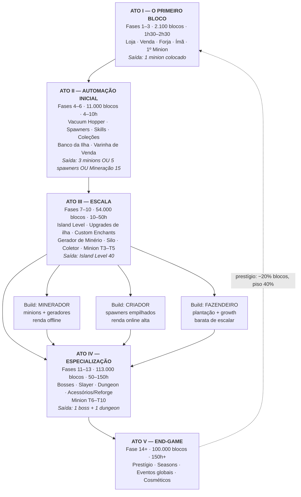
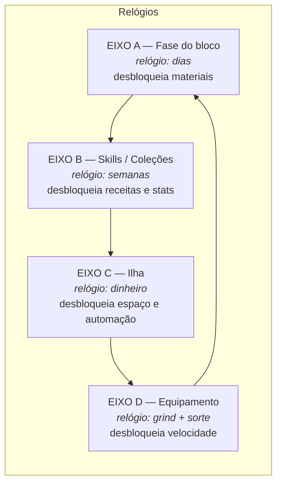
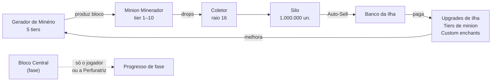
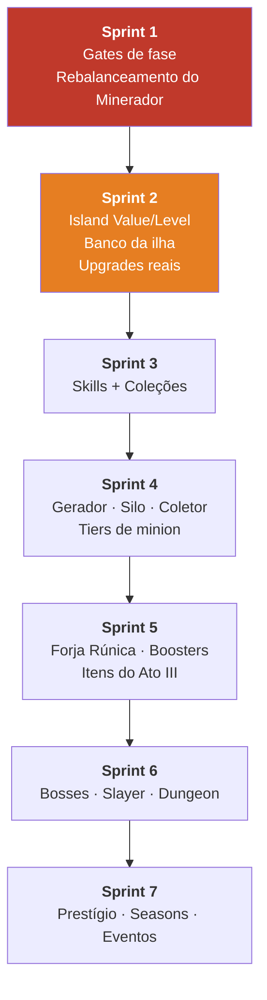

# Mapa de Progressão — Referência Visual

Data: 2026-07-26
Companheiro de: [plano dos atos](2026-07-26-progressao-atos.md) · [spec de progressão](../specs/2026-07-26-progressao-oneblock-design.md)

Documento de consulta rápida: os cinco atos numa vista só, matriz de desbloqueio por fase, e as curvas que precisam ser respeitadas no balanceamento.

---

## 1. Os cinco atos



Regra das três builds: precisam ficar dentro de **±20% de coins/hora** no mesmo nível de investimento. Se uma vence, o Auction House vira monocultura e o mercado morre.

---

## 2. Os quatro eixos paralelos



**Regra:** o jogador tem que ter tarefa aberta em pelo menos **3 dos 4 eixos** a qualquer momento. Quando só sobra um, ele sai.

Hoje o servidor só tem o Eixo A funcionando de verdade.

---

## 3. Matriz de desbloqueio por fase

| Fase | Nome | Blocos | Acum. | Ato | Desbloqueia |
|---|---|---|---|---|---|
| 1 | Origem | 300 | 300 | I | — (starter kit) |
| 2 | Profundezas Rasas | 600 | 900 | I | Loja de blocos, `/sell` |
| 3 | Profundezas de Ferro | 1.200 | 2.100 | I | Forja (`/craft`), Peça Mecânica |
| 4 | Caverna Dourada | 2.000 | 4.100 | II | Minion Minerador, borda nv1, Vacuum Hopper, spawners básicos, **Skills** |
| 5 | Caverna Abissal | 3.500 | 7.600 | II | Fazendeiro, Exterminador, **Coleções**, Varinha de Venda, Cristal Abissal |
| 6 | Picos Congelados | 5.500 | 13.100 | II | **Banco da Ilha**, Picareta de Explosão, Minion T2 |
| 7 | Ermos Glaciais | 8.000 | 21.100 | III | **Island Level**, upgrades de ilha, Núcleo Congelado |
| 8 | Terras Exóticas | 11.000 | 32.100 | III | **Forja Rúnica** (enchants), boosters, Gerador de Minério, Minion T3, Essência Exótica |
| 9 | Desolação Carmesim | 15.000 | 47.100 | III | Silo, Coletor, Fornalha Industrial, Cinza Carmesim |
| 10 | Areias de Almas | 20.000 | 67.100 | III | Minion T4, Bazaar, Mochila, Coração da Ilha |
| 11 | Fortaleza Vulcânica | 27.000 | 94.100 | IV | **Bosses de ilha**, Altar, Coração de Magma, Perfuratriz |
| 12 | Ecos do Vazio | 36.000 | 130.100 | IV | **Slayer**, Acessórios, Minion T5, Eco do Vazio |
| 13 | Cidades do End | 50.000 | 180.100 | IV | **Dungeon**, Reforge, Minion T6–T10, Fragmento Élitro |
| 14 | Escuridão Profunda | 100.000 | 280.100 | V | **Prestígio**, Estilhaço de Sculk |

Cada fase precisa desbloquear **alguma coisa nomeável**. Fase que só troca a textura do bloco é fase que o jogador não sente.

---

## 4. Curvas de balanceamento

### 4.1 Blocos por fase (crescimento ~×1,4)

```
Fase 1  ▏300
Fase 2  ▎600
Fase 3  ▌1.200
Fase 4  ▊2.000
Fase 5  █▍3.500
Fase 6  ██▏5.500
Fase 7  ███▏8.000
Fase 8  ████▎11.000
Fase 9  █████▉15.000
Fase 10 ███████▉20.000
Fase 11 ██████████▋27.000
Fase 12 ██████████████▎36.000
Fase 13 ███████████████████▊50.000
Fase 14 ███████████████████████████████████████▋100.000
```

Curva está saudável. O problema nunca foi a curva — foi ela ser o **único** eixo.

### 4.2 Velocidade do Minerador (segundos por bloco)

| Nível | Atual | Proposto | Blocos/h propostos |
|---|---|---|---|
| 0 | 10s | 20s | 180 |
| 1 | 9s | 17s | 212 |
| 2 | 8s | 15s | 240 |
| 3 | 7s | 13s | 277 |
| 4 | 6s | 11s | 327 |
| 5 | 5s (**1s** com Efficiency) | 9s | 400 |

Piso absoluto: 7s. Efficiency sai do cálculo de cooldown.

### 4.3 Energia proporcional à velocidade

`custo = 1 + nível_velocidade`

| Nível | Energia/bloco | Blocos por tanque (10.000) | Autonomia |
|---|---|---|---|
| 0 | 1 | 10.000 | 55h |
| 3 | 4 | 2.500 | 9h |
| 5 | 6 | 1.666 | 4h10 |

Velocidade passa a custar autonomia. Combustível vira demanda constante no AH.

### 4.4 Island Value

```
level = floor( sqrt( valor / 100 ) )
```

| Valor | Island Level |
|---|---|
| 10.000 | 10 |
| 160.000 | 40 ← gate de saída do Ato III |
| 1.000.000 | 100 |

Pontos base: `COBBLESTONE 1` · `IRON_BLOCK 40` · `DIAMOND_BLOCK 200` · `NETHERITE_BLOCK 1000` · `SPAWNER 300×stack` · `MINION 400×tier` · `GERADOR 500×tier`.

---

## 5. Fluxo de produção do Ato III

O desenho que substitui o "minion em cima do bloco central":



O ciclo fechado `gerador → minion → coletor → silo → banco → upgrade → gerador` é a fábrica. O bloco central fica fora dela de propósito: **progresso de fase é conteúdo do jogador, não do minion.**

---

## 6. Economia — fontes e sumidouros por ato

| Ato | Fontes | Sumidouros |
|---|---|---|
| I | Venda de drops, recompensa de fase | Ímã, borda nv1 |
| II | + spawners, minions, missões | + minions, upgrades de ilha, combustível |
| III | + auto-sell, Auction House | + enchants, boosters, tiers, taxa de 3% do AH |
| IV | + drops de boss, dungeon | + reforge (rolagem infinita), chaves, acessórios |
| V | + eventos | + cosméticos, loja de prestígio |

**Regra:** todo sistema novo que gera renda entra junto com um sumidouro do mesmo ato. Reforge e enchants são os melhores porque consomem sem fim.

---

## 7. Ordem de execução



Sprint 1 é o mais urgente **e** o mais barato: é ajuste de números mais um `if` em `MinerBehavior.mine()`. Nenhum sistema novo. Tudo depois disso é construído em cima dele.

---

## 8. Métricas de validação

| Métrica | Alvo |
|---|---|
| Tempo mediano Fases 1–3 | < 2h30 |
| Tempo mediano Fase 14 | > 40h |
| Jogadores que colocam o 1º minion | > 80% |
| Jogadores que colocam o 3º minion | > 40% |
| Blocos do Ato II vindos de automação | ~60% |
| Nenhuma fonte de renda isolada | < 50% do total |
| Spread de coins/hora entre as 3 builds | ± 20% |
| Retenção D7 por ato de parada | medir onde a curva quebra |
